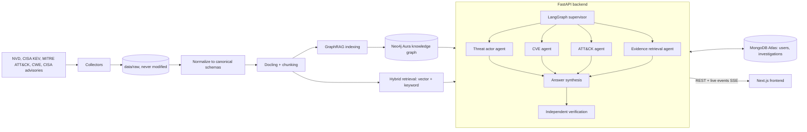

# CyberIntelGraph

**An evidence-first cyber threat intelligence (CTI) research assistant.** Ask a question about a vulnerability, an ATT&CK technique, a threat actor, a malware family, a weakness or a CISA advisory. Specialist agents query a Neo4j knowledge graph and the original source documents, write an answer made of individual claims, and an independent verifier checks every claim against the evidence before you see it. When verification is weak, the report waits for a human to approve it.

> Research tool only. It does not write exploits, scan or attack systems, or take any action on your network.

---

## Contents
1. [What you can ask](#what-you-can-ask) (and what you cannot)
2. [How to use the app](#how-to-use-the-app)
3. [How it works](#how-it-works)
4. [Data sources](#data-sources)
5. [Run it locally](#run-it-locally)
6. [Configuration](#configuration)
7. [API overview](#api-overview)
8. [Testing and evaluation](#testing-and-evaluation)
9. [Deployment (Fly.io + Vercel)](#deployment-flyio--vercel)
10. [Security](#security)
11. [Repository layout](#repository-layout)
12. [Milestones](#milestones)
13. [Limitations](#limitations)

---

## What you can ask

The system answers questions about the entities in its knowledge graph and the documents behind them. Supported question types:

| Type | Example questions | What you get |
|---|---|---|
| **Vulnerability (CVE)** | `What is known about CVE-2023-23397?` | Affected vendor/product, weakness (CWE), known-exploitation status, linked advisories or actors when they exist in the data |
| **Weakness (CWE)** | `What is CWE-79?` | Name and description of the weakness, related CVEs in the graph |
| **ATT&CK technique** | `What is MITRE ATT&CK technique T1059?` / `Show evidence for T1059 usage` | Technique description, tactics, actors and malware linked to it, supporting source passages |
| **Threat actor** | `Which techniques does APT28 use?` | Aliases, techniques, tools and malware, campaigns, with the source of each link |
| **Malware or tool** | `What is Mimikatz?` | Description, techniques it implements, actors that use it |
| **CISA advisory** | `What does CISA advisory AA22-103A cover?` | Summary, entities mentioned (actors, CVEs, techniques), publication date and URL |
| **Relationships across the above** | `Which vulnerabilities are linked to a ransomware group?` | A cited answer only if those links exist in the data; otherwise a clear statement that none were found |

**Writing good questions**
- Name the thing: a CVE id (`CVE-2024-3400`), a technique id (`T1566`), an actor (`APT28`), an advisory id (`AA20-302A`).
- One subject per question. Compare two things by asking twice.
- Make each question stand on its own. Every question is investigated independently, so "what about its techniques?" will not know what "its" refers to.
- Write at least 5 characters, in English.

**What it will not do**
- General conversation, coding help, or anything outside cyber threat intelligence.
- Write, adapt or run exploits or malware, scan hosts, or perform any attack.
- Look up your own assets, incidents, logs or alerts. It only knows the public sources below.
- Predict the future ("will this CVE be exploited next month?") or give legal, medical or financial advice.
- Guarantee that something does not exist. "No claims could be supported" means the evidence available to the system did not support an answer, not that the thing is absent from the world.
- Remember earlier questions in the same chat (see [Limitations](#limitations)).

---

## How to use the app

1. **Create an account** at `/register` (name, email, password of at least 10 characters), or sign in at `/login`.
2. **Start a chat.** The first question goes in the centred box. Click a suggestion or type your own and press Enter (Shift+Enter for a new line).
3. **Watch the Pipeline panel** on the right. It streams each step live: the supervisor's plan, which agents run (threat actor, CVE, ATT&CK, evidence retrieval), answer synthesis and independent verification. A retry appears if an agent had to run again.
4. **Read the verified answer.** It shows an overall confidence and chips such as `4 confirmed`. Open **Claims and verification** to see every claim with its status, confidence and number of evidence items.
5. **Open the full report** for tabs: **Report**, **Live knowledge graph** (entities and relationships behind the answer; bright edges are the ones the answer cites) and **Evidence** (the original passages with source, date and link).
6. **Approve when asked.** If verification finds contradictions, unknown identifiers or low confidence, the run is marked *Needs approval*. Review the claims, then click **Approve report**.
7. **Ask more questions in the same chat.** The box moves to the bottom after your first question. The sidebar lists your chats by date, with search. Close the sidebar to get a slim icon rail.

**Other pages**
| Page | Use it to |
|---|---|
| Dashboard | See investigation counts, items awaiting approval, graph size by entity type, agent activity and system status (Neo4j, MongoDB, LLM key, webhook) |
| Intelligence explorer | Browse entities by type (threat actors, malware, vulnerabilities, techniques, campaigns, tools, software, weaknesses) and see their direct relationships |
| Knowledge graph | Search an entity, click nodes to expand neighbours, switch live watch on to refresh when the graph changes |
| Evidence explorer | Search the source passages behind the graph (at least 3 characters). Each result keeps its source and date |
| Reports and history | List every chat with its latest status |
| Settings | Change your name, set an outbound webhook URL and send a test event |

**Status labels**
| Label | Meaning |
|---|---|
| Confirmed | The claim is supported by evidence the verifier checked |
| Reported | A source reports it, without independent confirmation |
| Inferred | Derived from other facts rather than stated directly |
| Candidate | Extracted but not yet validated; shown dashed in the graph |
| Not found | Searched for, nothing found (not proof of absence) |
| Unverified / Unable to verify | The verifier could not support or check the claim. Do not rely on it |

Run statuses: *Running*, *Completed*, *Needs approval*, *Failed*.

---

## How it works



- **Agents** are chosen per question by the supervisor. Failed or empty steps are retried or reported as limitations; an API error is never reported as "does not exist".
- **Verification** is separate from synthesis. Each claim gets a status, confidence and evidence ids. Contradictions and gaps are listed under *Limitations*.
- **Provenance**: every fact keeps its source, URL and date.

---

## Data sources

| Source | Used for |
|---|---|
| NVD | CVE records and scores |
| CISA Known Exploited Vulnerabilities (KEV) | Evidence of exploitation in the wild |
| MITRE ATT&CK | Techniques, actors, malware, tools, campaigns |
| CWE | Weakness definitions |
| CISA advisories | Narrative reports and the entities they name |

Raw downloads are stored in `data/raw/` and never modified (not committed to git). Check each provider's terms before redistributing their data. ATT&CK and CWE are MITRE publications.

---

## Run it locally

**Prerequisites:** Windows PowerShell, Python 3.12, Node.js 20 or newer, a Neo4j Aura instance, a MongoDB Atlas cluster, a Groq API key.

```powershell
git clone https://github.com/<your-account>/CyberIntelGraph.git
cd CyberIntelGraph
.\scripts\setup_env.ps1                 # creates the Python 3.12 virtual environment
.\.venv\Scripts\Activate.ps1
python -m pip install -r requirements.txt
Copy-Item .env.example .env             # then fill in your own values (see Configuration)
```

Build the knowledge base once by following the milestone guides in `docs/pipeline/` (collectors, normalization, chunking, GraphRAG indexing, Neo4j synchronization). Then:

```powershell
# terminal 1: API  (interactive docs at http://127.0.0.1:8000/docs)
python -m uvicorn backend.main:app --reload

# terminal 2: frontend  (http://localhost:3000)
cd frontend
npm install
npm run dev
```

The frontend reads the API address from `NEXT_PUBLIC_API_URL` (default `http://localhost:8000`).

---

## Configuration

Copy `.env.example` to `.env`. Never commit `.env`; `.env.example` must contain placeholders only.

| Variable | Purpose |
|---|---|
| `NVD_API_KEY` | NVD API key for the collector |
| `GROQ_API_KEY`, `GROQ_MODEL` | LLM provider key and model |
| `EMBEDDING_MODEL` | Embedding model name (default `BAAI/bge-m3`) |
| `NEO4J_URI`, `NEO4J_USERNAME`, `NEO4J_PASSWORD`, `NEO4J_DATABASE` | Neo4j Aura connection |
| `MONGODB_URI`, `MONGODB_DB` | MongoDB Atlas connection (without it, history is lost on restart) |
| `JWT_SECRET` | Signs login tokens |
| `WEBHOOK_SECRET` | Signs outbound webhook events |
| `HTTP_TIMEOUT_SECONDS`, `USER_AGENT` | Collector settings |
| `NEXT_PUBLIC_API_URL` | Frontend only: public URL of the API (visible in the browser, never put a secret here) |

Generate secrets with `python -c "import secrets; print(secrets.token_urlsafe(48))"`.

---

## API overview

All routes are under `/api` and, except register and login, need `Authorization: Bearer <token>`. Full schemas: `/docs`.

| Route | Purpose |
|---|---|
| `POST /api/auth/register`, `POST /api/auth/login` | Create an account, sign in (returns a token) |
| `GET /api/auth/me`, `PATCH /api/auth/me` | Read or update your profile and webhook URL |
| `POST /api/investigations` | Start an investigation (`{"question": "..."}`), returns an id |
| `GET /api/investigations`, `GET /api/investigations/{id}` | History, and one investigation with answer, claims and verification |
| `GET /api/investigations/{id}/events` | Live pipeline events (Server-Sent Events) |
| `GET /api/investigations/{id}/graph` | Entities and relationships behind an answer |
| `POST /api/investigations/{id}/approve` | Approve a report that needs approval |
| `GET /api/dashboard` | Counts, graph size, agent activity, system status |
| `GET /api/graph/entities`, `GET /api/graph/subgraph`, `GET /api/graph/watch` | Explore the graph (watch is a live stream) |
| `GET /api/evidence/search` | Search source passages |
| `POST /api/webhooks/test` | Send a test webhook event |

---

## Testing and evaluation

```powershell
python -m pytest tests -q                       # backend tests
cd frontend; npx playwright test                # browser tests (API on :8000 and npm run dev running)
```

**Evaluation harness** (`evaluation/`): 26 benchmark questions (CVE, CWE, ATT&CK, actors, malware, advisories, multi-hop, non-existent items, safety) scored against the running API, plus HTTP and CORS checks.

```powershell
python evaluation\run_eval.py --base-url http://127.0.0.1:8000 --email <you@example.com> --password <password>
```

It reports hard pass rate, hallucination rate on non-existent items, safety accuracy, citation rate and p95 latency, and exits with an error if a quality gate fails. Questions and expected answers: `docs/evaluation/EVALUATION_QUESTIONS.md`. How to run and interpret: `docs/evaluation/EVALUATION_GUIDANCE.md`. Record measured results in `evaluation/reports/`; do not claim one retrieval method beats another without measurements.

---

## Deployment (Fly.io + Vercel)

| Part | Where | Files |
|---|---|---|
| API (FastAPI) | Fly.io | `Dockerfile`, `fly.toml`, `.dockerignore` |
| Frontend (Next.js) | Vercel, root directory `frontend` | `frontend/vercel.json` |
| Graph and data | Neo4j Aura, MongoDB Atlas | hosted services |

Order: deploy the API, set `NEXT_PUBLIC_API_URL` in Vercel to the Fly URL, deploy the frontend, then allow the Vercel URL in the API's CORS settings. Step-by-step commands, MongoDB network access, streaming notes and a checklist: `docs/deployment/DEPLOYMENT_GUIDE.md`.

---

## Security

- Secrets live only in `.env` (local) and `fly secrets` (production). They are never committed. If a key was ever pasted into a file, a chat or a screenshot, rotate it.
- Passwords are at least 10 characters; sessions use signed tokens; webhook events are signed.
- Before opening a public deployment, review: who may register, rate limiting, per-user data isolation, CORS origins, dependency versions and Fly/Vercel secret handling.
- The assistant is research-only: no exploit generation, scanning or destructive actions.

---

## Repository layout

| Folder | Purpose |
|---|---|
| `ingestion/` | Collectors (NVD, CISA KEV, MITRE ATT&CK, CWE, advisories), document processing, chunking, normalization, validation |
| `canonical/` | Canonical schemas, entities, relationships, provenance |
| `graphrag_engine/` | GraphRAG indexing, export, retrieval, synchronization to Neo4j |
| `neo4j_engine/` | Connection, schema, Cypher queries, repositories |
| `database/` | MongoDB persistence |
| `agent/` | LangGraph supervisor, nodes, tools, prompts, state |
| `backend/` | FastAPI application |
| `frontend/` | Next.js + TypeScript interface |
| `evaluation/` | Benchmark questions, metrics and the evaluation harness |
| `tests/` | Unit, integration and evaluation tests |
| `scripts/` | Setup and check scripts |
| `docs/` | Guides, pipeline documentation, deployment and evaluation guides |
| `data/`, `outputs/`, `logs/` | Generated content, not committed |

---

## Milestones

| # | Milestone | # | Milestone |
|---|---|---|---|
| 1 | Environment and structure | 10 | GraphRAG inspection and Neo4j sync |
| 2 | Data source selection | 11 | Neo4j schema and Cypher retrieval |
| 3 | Individual collectors | 12 | MongoDB persistence |
| 4 | Raw data validation | 13 | LangGraph supervisor and tools |
| 5 | Canonical schemas | 14 | Evidence verification and live fallback |
| 6 | Document processing | 15 | Report generation and FastAPI |
| 7 | Naive RAG baseline | 16 | Frontend (Next.js) |
| 8 | Hybrid RAG | 17 | Evaluation and benchmarking |
| 9 | GraphRAG indexing | 18 | Integration, security review, deployment |

Details and run commands: `docs/pipeline/00_milestone_roadmap.md`. Current state: `PROJECT_STATUS.md` and `CHANGELOG.md`.

---

## Limitations

- **Coverage:** answers come only from the ingested snapshot of the sources above. Newer CVEs, advisories or ATT&CK releases appear only after the collectors are re-run.
- **Independent questions:** each question is investigated on its own. A chat groups questions but does not pass earlier answers to later ones.
- **Chats are stored in your browser** (the investigations themselves are stored on the server). Clearing site data loses the chat grouping, not the investigations.
- **Verification reduces errors, it does not remove them.** The verifier and the answer writer are both language-model based. For decisions that matter, follow the evidence links to the primary source.
- **Quality numbers** are only what the evaluation harness measured on its question set, at the time it was run.
